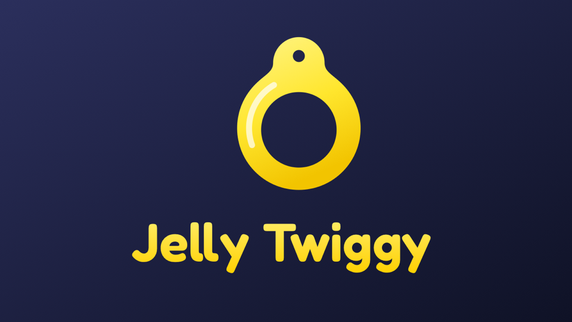

# Jelly Twiggy

Jelly Twiggy extends the Jellyfin web client with poster badges, playback options, active streams, a customizable dashboard and watch history.

## Features

- Poster badges: quality, first audio track, and rating
- User preferences for: Auto-skip intro and outro, Auto-pause, auto-resume and auto Picture-in-Picture on tab switch
- Long press / hold for 2x speed
- Option to hide favorites everywhere
- Active streams button with progress, device and transcoding details
- Dashboard: show, hide and reorder blocks, devices in the active streams style
- Playback statistics
- "Watched" row on item pages
- Localization (English, German, Russian)

## Install

Add the repository in **Dashboard → Plugins → Repositories**:

    https://raw.githubusercontent.com/andrey-lysikov/jellyfin-plugin-jelly-twiggy/manifest/manifest.json

Install **Jelly Twiggy** from the catalog and restart the server.

## Tech

C# / .NET 10 for Jellyfin 12.x, requires [File Transformation](https://github.com/IAmParadox27/jellyfin-plugin-file-transformation).

Based on: [Jellyfin-Enhanced](https://github.com/n00bcodr/Jellyfin-Enhanced), [File Transformation](https://github.com/IAmParadox27/jellyfin-plugin-file-transformation), [Intro Skipper](https://github.com/intro-skipper/intro-skipper)

License: [GPL-3.0](LICENSE)
