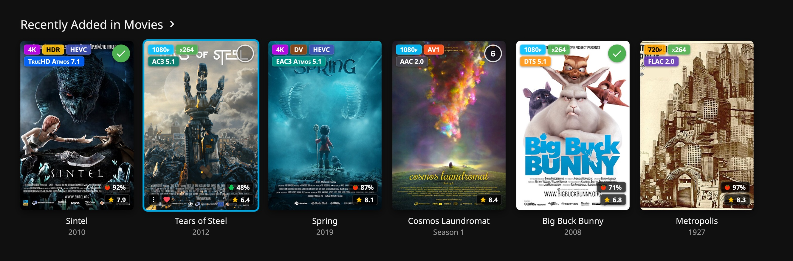
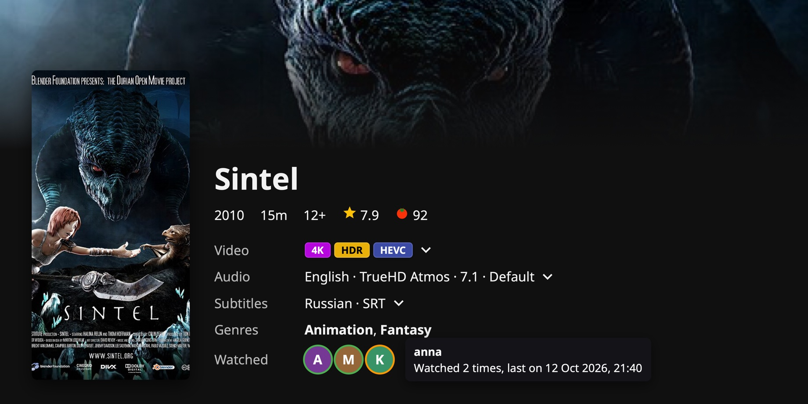
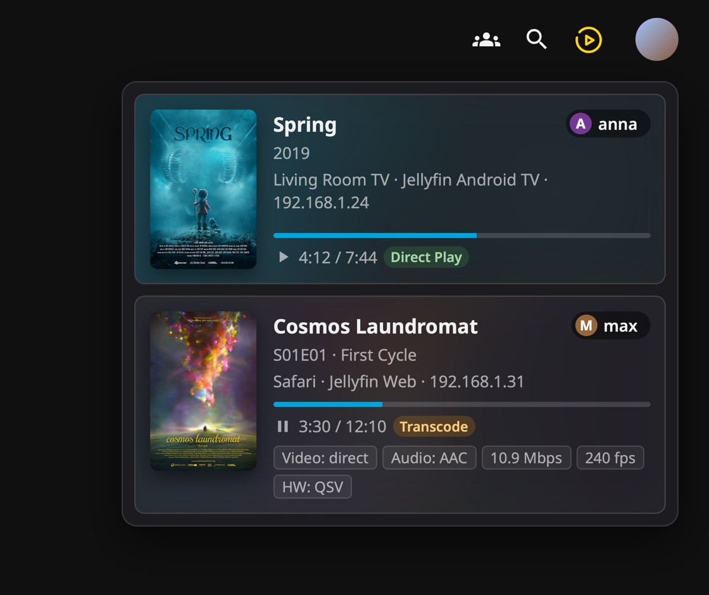
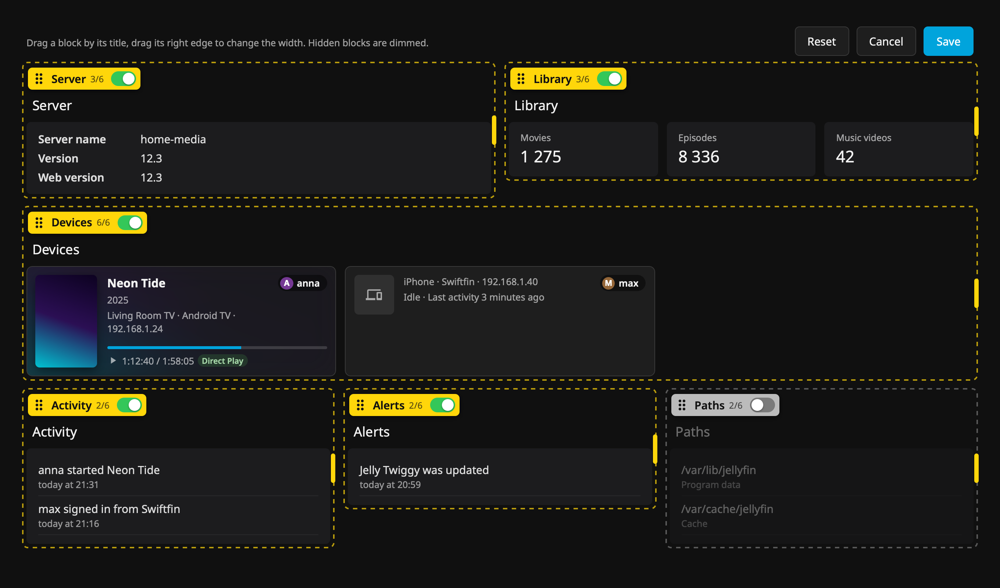
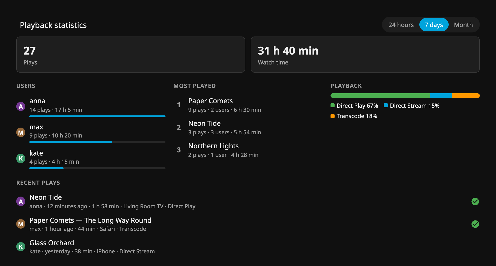
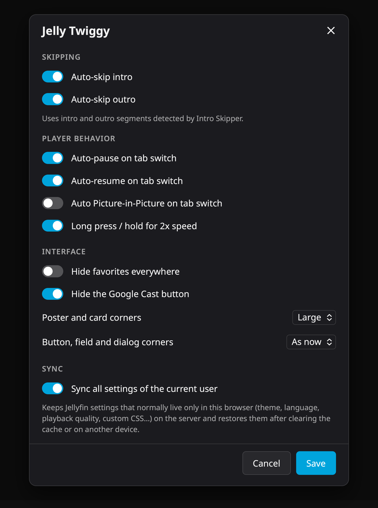

<picture>
  <source media="(prefers-color-scheme: dark)" srcset="assets/wordmark-dark.png">
  
</picture>

Jelly Twiggy extends the Jellyfin web client with poster badges, playback options, active streams, a customizable dashboard and watch history.

## Features

- Poster badges: resolution, HDR / DV, codec, first audio track, rating and Rotten Tomatoes score
- User preferences for: Auto-skip intro and outro, Auto-pause, auto-resume and auto Picture-in-Picture on tab switch
- Long press / hold for 2x speed
- Options to hide favorites and the Google Cast button, corner radius of cards and of the interface
- Sync of Jellyfin's browser-only settings across browsers and devices
- Active streams button with progress, device and transcoding details
- "Continue here" and "Play on…" between your devices, compatible with Swiftly Player
- Dashboard: move, resize, show and hide blocks, and more
- "Watched" row on item pages with who watched, how many times and when
- Localization (English, German, Russian)

## Screenshots

  

  
  

  

  
  

*Screenshots use posters of the Blender open movies Big Buck Bunny, Sintel, Tears of Steel, Spring and Cosmos Laundromat (© Blender Foundation, CC BY) and Boris Bilinsky's Metropolis poster (public domain); users and statistics are made up.*

## Install

Add the repository in **Dashboard → Plugins → Repositories**:

    https://raw.githubusercontent.com/andrey-lysikov/jellyfin-plugin-jelly-twiggy/manifest/manifest.json

Install **Jelly Twiggy** from the catalog and restart the server.

## Tech

C# / .NET 10 for Jellyfin 12.x, requires [File Transformation](https://github.com/IAmParadox27/jellyfin-plugin-file-transformation).

Based on: [Jellyfin-Enhanced](https://github.com/n00bcodr/Jellyfin-Enhanced), [File Transformation](https://github.com/IAmParadox27/jellyfin-plugin-file-transformation), [Intro Skipper](https://github.com/intro-skipper/intro-skipper)

License: [GPL-3.0](LICENSE)
